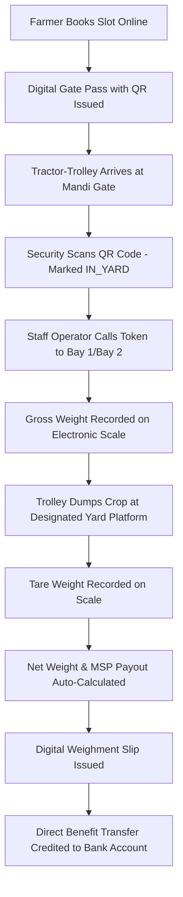

# KisanSetu (किसान सेतु) 🌾
### Smart Mandi Procurement & Queue Management System

> **Eliminating highway bottlenecks, paper chits, and arbitrary waiting during agricultural procurement with digital tokens, automated dual-weighbridges, and transparent MSP direct benefit transfers.**

[](https://vitejs.dev/)
[](https://react.dev/)
[](LICENSE)
[](#)

---

## 📌 Problem Overview

During harvesting seasons across Indian grain belts (Punjab, Haryana, UP, MP, Rajasthan, Gujarat):
- **18 to 48 Hours Highway Waiting**: Thousands of tractor-trolleys camp along national highways outside APMC mandis in extreme weather.
- **Manual Gate Chokepoints**: Paper tokens lead to favoritism, queue jumping, and traffic gridlocks.
- **Weighbridge Inaccuracies**: Manual weight recordings delay unloadings and cause payment disputes.
- **Payment Delay & Lack of Tracking**: Farmers are uncertain when their procurement receipts will be approved and paid via DBT.

---

## 🚀 The KisanSetu Solution

**KisanSetu** is an end-to-end digital queue orchestration and procurement platform designed to restore order, dignity, and transparency to mandi yards:

1. **Advance Slot Scheduling**: Farmers book guaranteed arrival windows for their tractor-trolley or mini-truck.
2. **Digital QR Gate Pass**: Token generated with an encrypted QR code for instant barcode/QR verification at Gate #1.
3. **Live Public Queue & Token Board**: Real-time public dashboard showing *Now Calling to Bay*, *At Weighbridge*, and *In Yard Parking*.
4. **Dual Weighbridge Protocol**: Digital Gross Weight (loaded) and Tare Weight (empty post-dumping) calculation with automatic moisture deduction.
5. **Direct DBT Payment Release**: Generates electronic weighment slips and submits payment requests directly to PFMS/bank accounts within 24–48 hours.

---

## 🏛️ Dedicated Portals & Workspaces

The platform features an integrated role switcher for all stakeholders:

### 1. 🌐 Public Portal & Live Queue Board
- Live operational telemetry for major mandis (Khanna, Karnal, Bharatpur, Rajkot, Indore).
- Real-time Yard Occupancy (trolleys in queue, average wait times, open weighbridge bays).
- Live 4-stage token display (*Now Calling*, *At Weighbridge*, *In Yard*, *Upcoming*).
- Official MSP price gazette for Wheat, Paddy, Mustard, Cotton, Chana, and Maize.

### 2. 👨‍🌾 Farmer Portal
- Active token status banner with live countdown and queue position.
- Interactive **"Book Procurement Slot"** with live MSP payout calculator.
- Verifiable **Digital QR Gate Pass** with printable layout.
- My Bookings table, electronic weighment slip viewer, and DBT bank transfer ledger.

### 3. 🏢 Mandi Staff Operations Console
- Gate Check-In station: Search vehicle registration plate or scan QR token.
- Yard Queue Management: Call next trolley to **Weighbridge Bay 1** or **Bay 2** with a single click.
- Automated Weighbridge Desk: Enter Gross & Tare weights to compute Net Quintals and issue official digital receipts.

### 4. 🏛️ District Administration Portal
- Real-time yard congestion gauges and district procurement targets vs. achievements.
- **Bottleneck Cycle Analysis**: Identifies delays across Gate Verification (avg 3.8m), Weighbridge Operations (avg 7.2m), and Unloading (avg 14.5m).
- Editable crop MSP rates and daily farmer quota caps.
- Cryptographic operational audit trail.

---

## 🛠️ Technology Stack

- **Frontend Framework**: React 19 (ESModules)
- **Build System & Dev Server**: Vite 8
- **Styling**: Tailored Modern Vanilla CSS Design System with responsive mobile bottom navigation
- **Iconography**: [Lucide React](https://lucide.dev/)
- **Micro-Interactions & Celebrations**: Canvas Confetti
- **State & Storage**: Reactive Client-side Store with `localStorage` persistence

---

## 📦 Getting Started

### Prerequisites
- Node.js (v18 or higher recommended)
- npm (v9 or higher)

### Installation

1. **Clone the repository:**
   ```bash
   git clone https://github.com/Veerendrakumarkr2137/KisanSetu.git
   cd KisanSetu
   ```

2. **Install dependencies:**
   ```bash
   npm install
   ```

3. **Start the local development server:**
   ```bash
   npm run dev
   ```

4. **Open in your browser:**
   ```
   http://localhost:5173/ (or assigned port)
   ```

5. **Build for production:**
   ```bash
   npm run build
   ```

---

## 📋 Procurement Workflow Stages



---

## 📞 Mandi Control Room Helpline

- **Toll-Free Kisan Call Centre**: 1800-180-1551 (24x7 in 22 Regional Languages)
- **Emergency Mandi Queue Helpdesk**: support@kisansetu.gov.in

---

## 📄 License
This project is open-source under the [MIT License](LICENSE).
